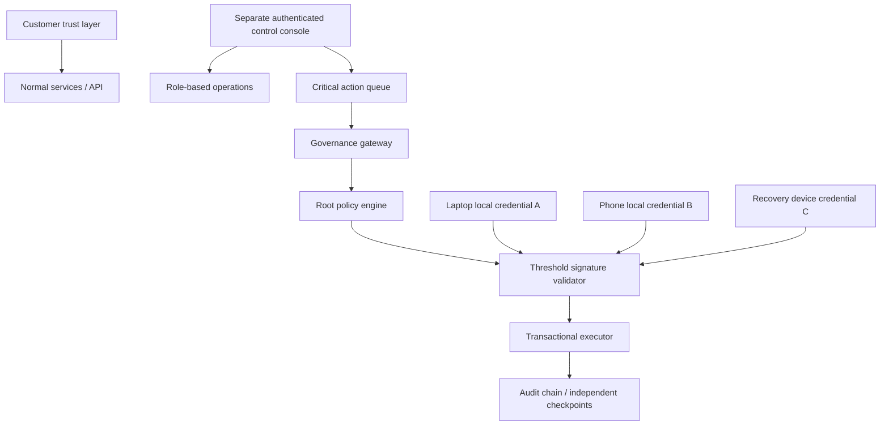

# LEQVOR Founder Authority Architecture v1

Status: accepted specification; local governance core and native client implementation started, not activated. The user explicitly requested implementation after the customer unlock release. governance/README.md records the tested policy/queue/gateway/transaction/audit implementation and its boundaries. Windows/Android clients compile and pass public-protocol interoperability; physical signing, attestation validation and enrollment are pending. Separate online admin console and protected infrastructure executors remain unbuilt. governance/MANUAL-ACTIVATION.md distinguishes manual requirements from unfinished integration. Supersedes the single-key founder proposal. Customer release d23e534 is deployed, but outstanding customer acceptance and security/operations work is not thereby complete. Preserve the current customer UI.

## Boundaries

Customer system: Overview, Vault, People, Continuity, Recovery, Sharing, Insurance and Security. Customer VMKs, record keys and recovery secrets remain separate from all governance identities. Founder approval never decrypts a customer vault or gives a support/admin user its plaintext.

Current permanent customer origin remains leqvor.vercel.app, including its passkey binding. app.leqvor.com and admin.leqvor.com are target origin boundaries, not configured domains. Do not move the customer RP or activate an admin origin implicitly.

## Roles and levels

Control-console roles: FOUNDER, SECURITY_ADMIN, OPERATIONS_ADMIN, SUPPORT_ADMIN, BILLING_ADMIN and AUDITOR. These roles have explicit least-privilege permissions. A FOUNDER role alone is not a root credential. Normal admins cannot execute root operations or replace the key pins, threshold or authorizer.

Level 1: normal operational actions require scoped admin authentication and an audit event. User support must not reveal customer ciphertext contents or bypass customer consent.

Level 2: security-sensitive operations require authorized founder/security-admin identity, fresh authentication and an audit event. Deployment approvals, secret rotation and security-policy changes must be classified by effect: touching the root authorizer, its dependencies, trust pins, enforcement configuration or infrastructure control is Level 3, regardless of an ordinary deployment/rotation label.

Level 3: REMOVE_FOUNDER_ROOT, DISABLE_FOUNDER_PROTECTION, TRANSFER_PLATFORM_OWNERSHIP, REPLACE_FOUNDER_IDENTITY, CHANGE_ROOT_POLICY, CHANGE_ROOT_THRESHOLD, TRANSFER_CRITICAL_INFRASTRUCTURE and DELETE_GOVERNANCE_CONFIGURATION require distinct 2-of-3 founder signatures. All weakening operations use the 72-hour cooling and second-confirmation process below. No ordinary admin bypass or support recovery override.

## Founder authority mesh

A is a laptop credential, B a phone credential, C a separately held recovery-device credential. The public registry stores slot, public key, key fingerprint, credential type, registration version and revocation state. Private keys never reach the website, API, Supabase, Vercel, logs or backups. Separate device enrollment must verify possession and the actual hardware/non-exportability properties. Local biometrics/PIN authorize use of a key; they are not the signing key itself.

The Windows TPM/Hello and phone secure-hardware adapters are implementation/acceptance requirements, not properties inferred from a device name or checkbox. Do not count a copied or synchronized credential twice. Exactly one current identity per slot; duplicate key/credential identities cannot satisfy quorum. Hardware-backed claim requires the actual adapter and evidence. There is no production adapter yet. The revised architecture does not require a USB key but still requires a real separate recovery credential.

Local Founder Console: separate local desktop application and phone companion. No public founder hostname or listening public web server. Import requests by explicit transfer; display full operation, target and consequences, then sign through the local protected credential. The companion receives the identical request commitment, not a generic push approval. It exposes pending requests, approval/rejection, freeze, device/root-policy management, recovery and audit verification. Remote requests are untrusted until independently checked.

## Exact request and quorum

Version 1 signed commitments include domain, platform/environment, action, exact target, request_id, random 256-bit nonce, created_at, expires_at, governance_version, policy_hash, phase and proposal_hash. Policy hash commits to the complete canonical root policy, current slot identities, threshold and cooling rules. Display exact account IDs and inspected target artifacts; names alone are insufficient. Encoding, algorithms and adapter signature formats must be explicitly versioned and reviewed before implementation. The earlier single-key script format is not this protocol.

Each approval binds the full identical commitment and signer slot/credential identity. Ten-minute approval challenges expire and cannot be replayed. The trusted executor verifies current independently pinned policy/version, both distinct current credentials, exact target, signatures, expiry and unused request/nonces in one transaction. It consumes approvals, applies the action and advances version with its audit append atomically. Concurrent/replayed requests have at most one successful execution. Caller-provided policies, public pins, roles and completion scores are not authority.

## Cooling and freeze

For a weakening/root transfer request, phase PROPOSE collects 2-of-3 approvals and records an immutable proposal. It does not execute. The cooling deadline is trusted-executor time plus 72 hours. Expiry of the initial ten-minute signing challenge does not mean the proposal becomes executable automatically. After cooling, issue a fresh ten-minute CONFIRM challenge binding the exact proposal hash, action/target and unchanged policy/version. Collect a new 2-of-3 quorum before execution. Early confirmations, cancellation, key/policy changes and intervening governance changes invalidate execution. Notify all registered founder devices without leaking customer data; delivery is additional evidence, not authority.

GOVERNANCE_FREEZE allows one current founder credential to immediately block governance changes, privileged deployments, infrastructure transfers and root-secret rotation. It does not delete ciphertext or release customer keys. Normal safe customer services, encrypted backups and security logging continue. Unfreeze is a Level 3 action with 2-of-3, cooling and second confirmation. Freeze must be enforced at actual deployment and infrastructure-control paths, not only inside the app database.

## Recovery

Loss of one credential is handled by the two remaining current slots approving revocation and a new independently verified identity through the root process. Old key proofs are permanently denied after execution. Any exceptional recovery acceleration requires a separately reviewed policy; it is not silently implied by enrollment.

Loss of two devices is unresolved until an offline recovery-package protocol, independent verification authority, waiting period and remaining-key requirement are specified and reviewed. A recovery phrase alone must not take over governance. No catastrophic-recovery endpoint or admin override is authorized now. Define package storage, theft resistance, disclosure scope and loss behavior before collecting real recovery material.

## Infrastructure and audit enforcement

Supabase/Vercel/database owners can change code or mutable policy storage if nothing independently constrains them. Keeping private keys local does not alone prevent that bypass. The trust anchor and enforcement authority must therefore be outside ordinary application administration and protected against unilateral changes. This is an unresolved deployment dependency, not something RLS can solve against its own administrator.

Registry: GitHub organization/repository, Supabase, Vercel, domains/DNS, company email, secret manager, billing and production signing infrastructure. Record primary/backup owner, authentication/recovery method, last verification and root-approval applicability. Never put infrastructure private credentials in this registry.

Protect main, require reviews/security tests, verify production build provenance and enforce deployment authorization. Governance/security/API/migration changes and any dependency or configuration able to bypass them require stronger review. Branch rules alone do not constrain an infrastructure owner who can disable them; independent account controls and provider capabilities must be verified. No claims of transfer-proof ownership without those controls and legal ownership arrangements.

Governance audit uses canonical events, previous hashes, request/approval commitments and resulting version. Maintain independently retained signed checkpoints outside the primary writable audit store. Verify against external pins/checkpoints to detect substitution, truncation and forks. No independent checkpoint storage is configured yet. Permanent history retention and deletion obligations need reviewed policy; do not advertise indestructible history.

## Build gates

1. Finish preceding customer work: complete general Shield enforcement, live passkey acceptance, browser/two-account/device workflows, another-device recovery, separate backup storage/scheduling/cloud restore, independent security review and reviewed legal documents. Record what is blocked by unavailable devices/storage/reviewers.
2. Select and verify device adapters and separate recovery device. Define canonical mesh protocol, policy hash, two-phase state machine and loss recovery. Independent cryptographic review before strong claims.
3. Build offline desktop inspector/signer and phone companion. Test exact display-to-signature binding, local authentication, non-exportability and independence on real devices.
4. Build protected gateway/atomic queue/executor, one-key freeze and 2-of-3 cooled changes; wire every privileged path and independent audit/checkpoints.
5. Verify infrastructure-owner bypass resistance, build provenance, backup/recovery and real device quorum, then obtain explicit enrollment of actual founder devices before activation. No automatic domain change or customer UI redesign.

The user-provided 9.x ratings are aspirations, not measured assurances. Until these gates pass, Founder Root Authority remains inactive.
