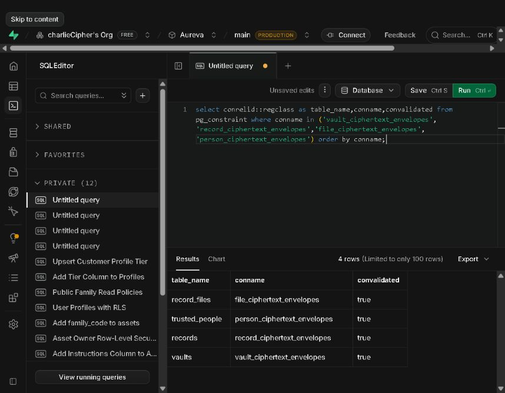

# Production validation — 28 September 2026

Target: existing Aureva/LEQVOR Supabase project `awdsyhxdnyfilnzamflt`.

## Completed

- Confirmed prerequisite V5 tables and transaction RPC were present.
- Ran envelope compatibility inspection in a rolled-back transaction: zero malformed rows in vaults, records, record_files and trusted_people. This is a compatibility result, not a claim that those tables contain customer records.
- Applied the SQL in `20260927_ciphertext_envelopes.sql` through the Supabase SQL editor with a 5-second lock timeout and 30-second statement timeout, followed by historical constraint validation in the same transaction.
- Independently queried `pg_constraint`: all four envelope constraints exist and `convalidated=true`.
- All 16 read-only readiness checks passed: forced/enabled RLS on ten V5 tables; private ciphertext bucket with configured MIME/size restrictions; three record RPCs; revoked direct authenticated record UPDATE/DELETE privileges; no authenticated cleanup-queue SELECT privilege.
- Made actual read-only HTTPS requests using the configured public app key: anonymous reads of vaults, records, record_files, trusted_people and ciphertext_cleanup_jobs were denied with PostgreSQL permission code `42501`. No row values or keys were printed.

## Scope and remaining checks

No customer record contents were rewritten or deleted. Deployment used the SQL editor, not CLI migration push; do not blindly rerun this migration without checking migration bookkeeping. Editor input issues initially caused duplicate-function/syntax errors; successful deployment and final catalog queries, rather than attempted executions, are the evidence recorded above.

Authenticated end-to-end acceptance remains pending. The available LEQVOR browser is signed out and no authenticated test-account credentials are configured. Two dedicated test accounts are needed to exercise actual login, vault creation, encrypted file upload/download, explicit reveal/hide, edit/delete and cross-account isolation through the hosted API. Passwords must be entered privately in the application, not pasted into chat. SQL readiness and anonymous denial do not substitute for these tests.

No backup restore, storage-worker execution, live recipient-sharing workflow or independent penetration test is certified by this report. The dashboard displayed no backup in its overview; this was not a full backup inventory.

Reproduce the read-only anonymous check with `node scripts/check-production-anonymous.mjs`. It is intentionally separate from the local release command and rejects a different project URL or an administrative key.
